# Orbisol

**From orbit to soil.** A mobile-first web app (PWA) that helps farmers explore crop rotation
strategies using NASA Earth observations, local soil information, crop characteristics and their
own priorities.

> Orbisol **supports, not replaces,** farmer judgment and local expertise.

**Live app: [orbisol.vercel.app](https://orbisol.vercel.app)** (works offline after the first visit; tap
"Demo farm near Tando Jam, Hyderabad" on the Field screen to see every layer).

- **Event:** NASA Space Apps Challenge 2026, Hyderabad (Pakistan) virtual local event
- **Challenge:** Field Shift: Adapting Farms with NASA Data
- **Team:** Orbisol, solo: Muhammad Awais
- **Case study:** Hyderabad, Sindh, Pakistan (25.40 N, 68.37 E), canal-irrigated. Works for any pin on land.

## What it does

1. Pin your field (GPS or map); enter your current rotation (e.g. cotton -> wheat), canal turn
   (warabandi), soil type and top priorities.
2. See **this season vs normal**: hot days, rain, extreme rain, frost, soil moisture and greenness,
   each with its source and date.
3. Compare **your existing rotation plus two alternatives**: why each was suggested, evidence,
   benefits, information gaps and risks that need local review.
4. **Season Twins** (past years most like this one), **Confidence Meter**, **seasonal calendar**
   (bare-field and vulnerable months), **Track Record** and **Water Fit**.

## Screenshots

Final design, demo farm near Tando Jam, Hyderabad: cotton -> wheat, salty soil = no, canal turn every 7 days,
priorities 1. Save water, 2. Fodder for animals. Phones at 360 x 800 (2x), desktop at 1440 x 900.

| Screen | Phone (360 x 800) | Desktop (1440 x 900) |
|---|---|---|
| 1. Field | 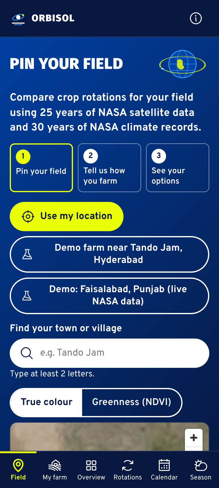 | 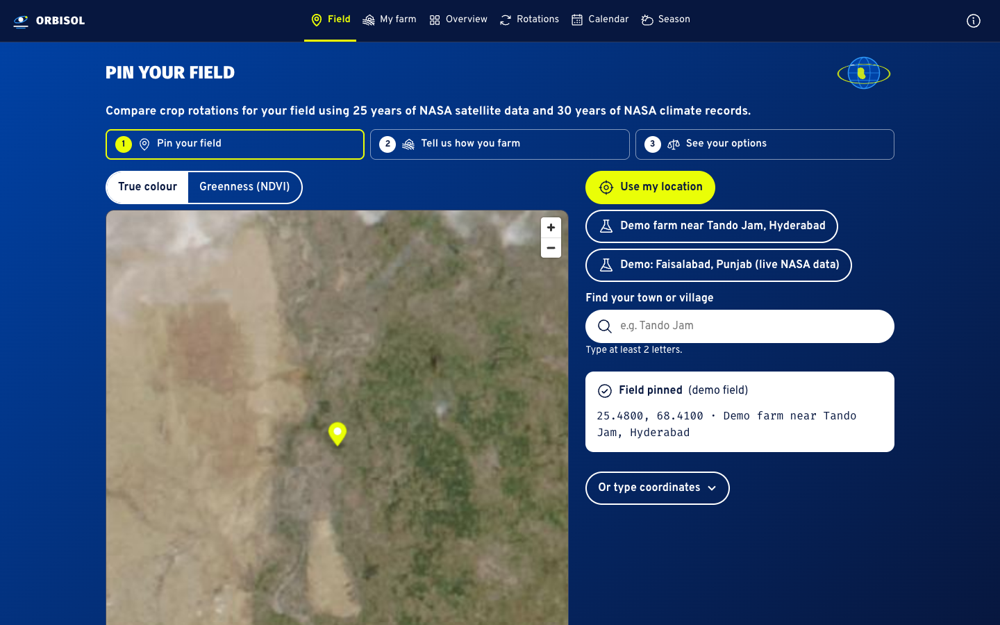 |
| 2. My farm | 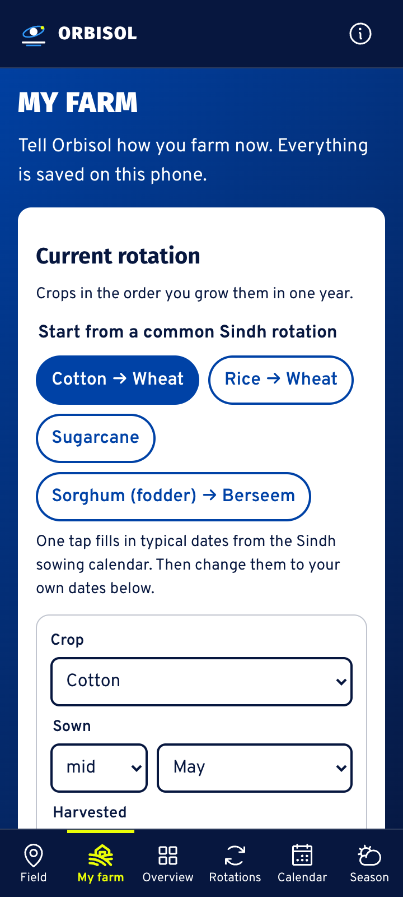 | 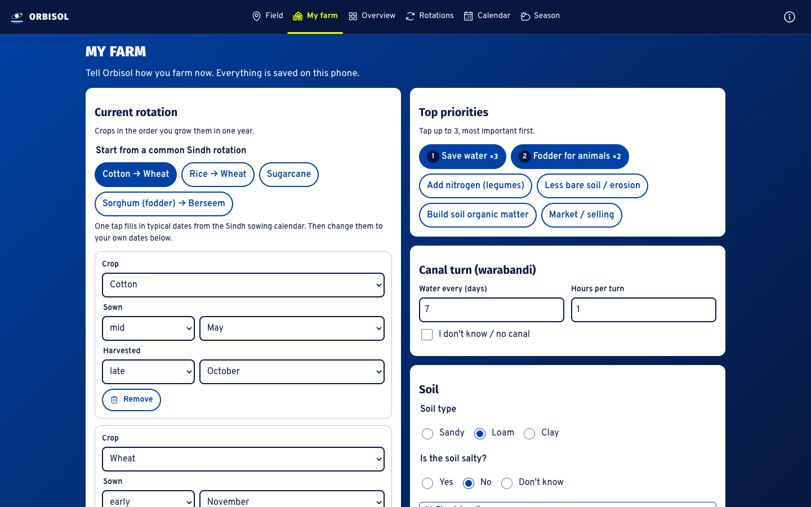 |
| 3. Overview | 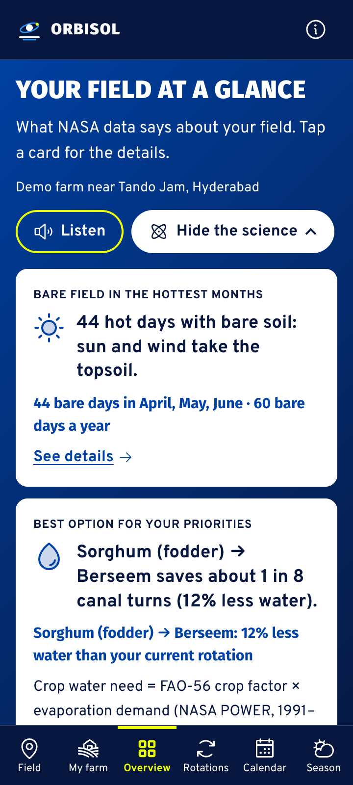 | 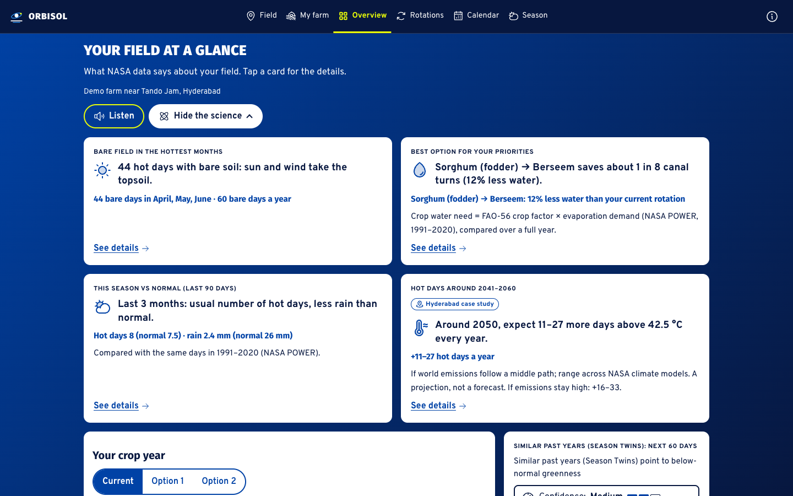 |
| 4. Rotations | 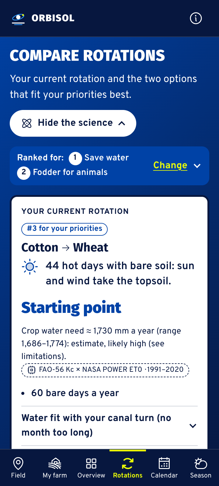 | 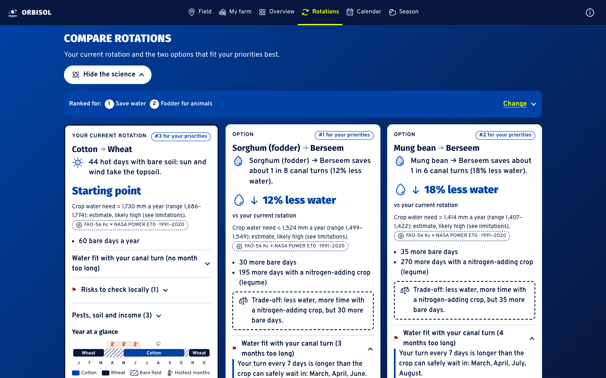 |
| 5. Calendar | 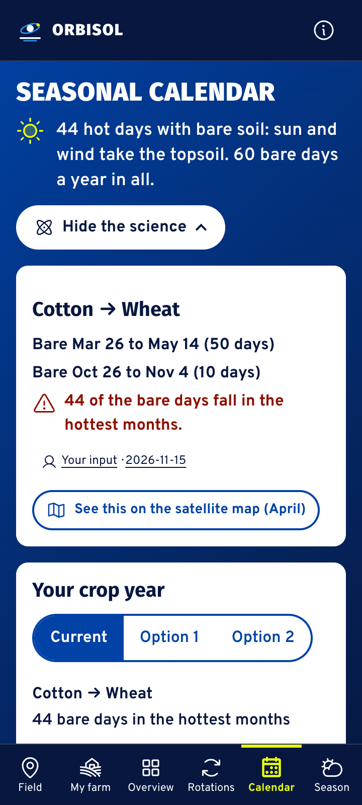 | 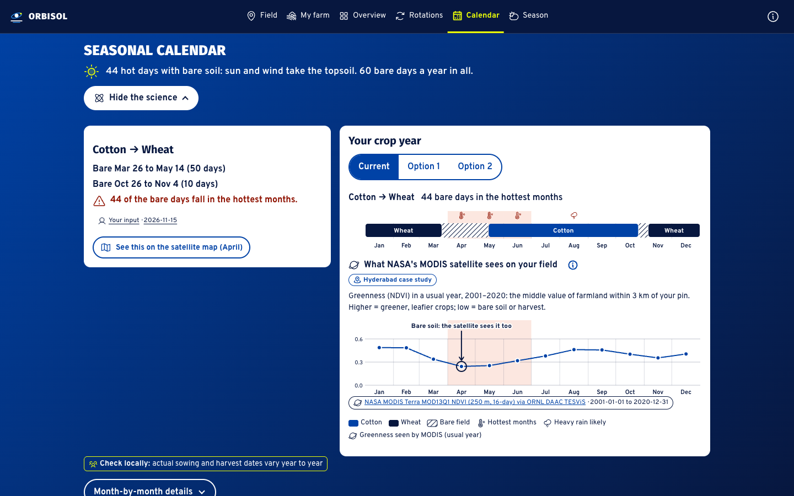 |
| 6. Season | 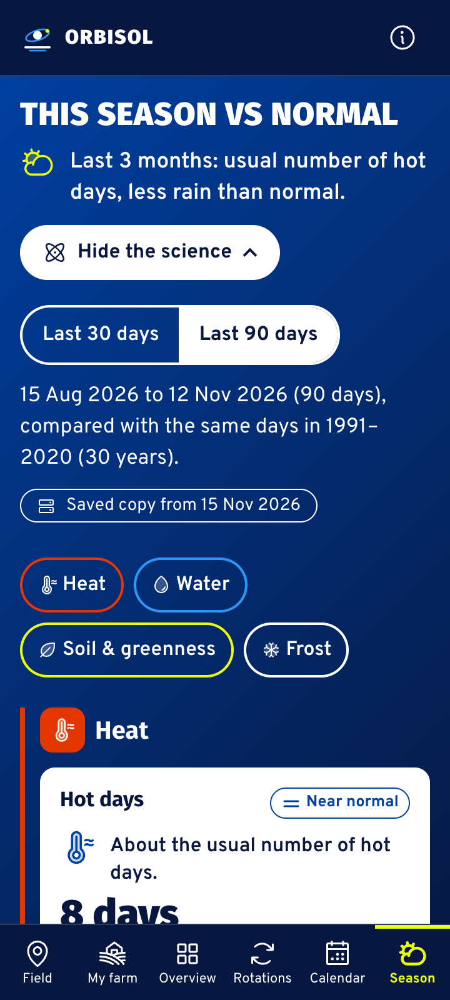 | 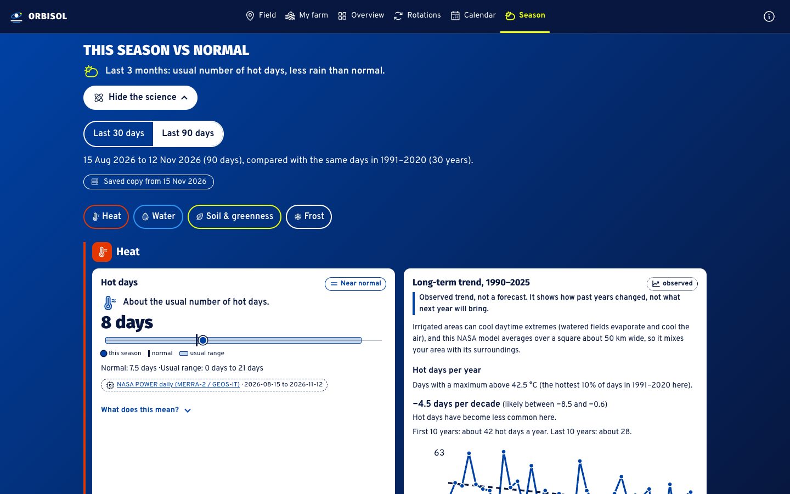 |
| 7. About | 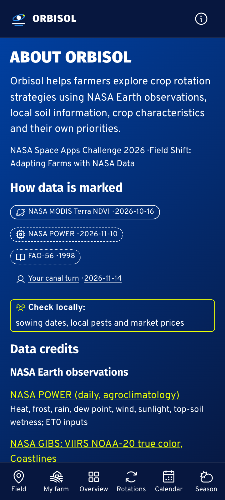 | 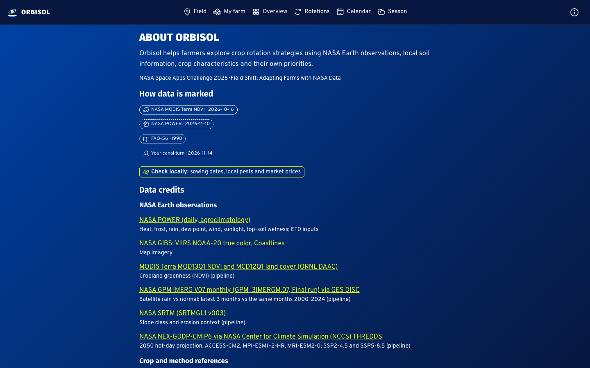 |

Full-length pages (2x): Overview [phone](docs/screenshots/03-overview-360x800-full@2x.png) /
[desktop](docs/screenshots/03-overview-1440x900-full@2x.png), Rotations
[phone](docs/screenshots/04-rotations-360x800-full@2x.png) / [desktop](docs/screenshots/04-rotations-1440x900-full@2x.png),
Calendar [phone](docs/screenshots/05-calendar-360x800-full@2x.png) /
[desktop](docs/screenshots/05-calendar-1440x900-full@2x.png), Season
[phone](docs/screenshots/06-season-360x800-full@2x.png) / [desktop](docs/screenshots/06-season-1440x900-full@2x.png).

Greenness map (NASA MODIS NDVI via GIBS), January vs April 2025:
[January](docs/screenshots/09-greenness-january-1440x900.png) / [April](docs/screenshots/09-greenness-april-1440x900.png).

## Repo layout

```
apps/web/        Vite + React PWA (MVC-inspired: models, views, controllers, services, stores)
packages/core/   Pure TypeScript domain engine + Vitest tests (no network, DOM or React)
pipeline/        Python scripts that precompute NASA data into data/*.json
data/            Static JSON fallback so the demo works offline / when APIs are down
docs/            architecture, data sources, limitations, AI usage, build log
```

## Run locally

```bash
npm install
npm run dev        # http://localhost:5173
npm test           # core engine tests
npm run check      # typecheck + tests
npm run build      # production build -> apps/web/dist
```

## Data credits

Used in this version (each number on screen names its source and dates):

- **NASA POWER** daily point API (NASA LaRC; MERRA-2 / GEOS-IT): heat, frost, rain, top-soil wetness and FAO-56 ET0, live
  for any pin.
- **GPM IMERG V07 monthly** (GPM_3IMERGM.07, NASA GES DISC): satellite rain vs normal (2000-2024).
- **NEX-GDDP-CMIP6** (NASA, via NCCS THREDDS): 2050 heat outlook, 3 models x SSP2-4.5 / SSP5-8.5, 2041-2060 vs
  1995-2014. A climate model projection, not a forecast.
- **MODIS Terra** MOD13Q1 NDVI and MCD12Q1 land cover (NASA / ORNL DAAC TESViS); MODIS NDVI 16-day map tiles via
  **NASA GIBS**.
- **SRTM** SRTMGL1 v003 (NASA / USGS, LP DAAC): slope and erosion context.
- **NASA GIBS** VIIRS NOAA-20 true-colour imagery and Coastlines_15m (© OpenStreetMap contributors).
- **FAO-56** (Allen et al. 1998) and **FAO GAEZ v4** crop references; **Sindh Agriculture Department** sowing calendar;
  **Feedipedia** (INRAE, CIRAD, AFZ, FAO) for legumes and fodder.
- **GeoNames** place names, [CC BY 4.0](https://creativecommons.org/licenses/by/4.0/).
- Published comparison for the observed heat trend: **Khan et al. 2022**, *PLOS ONE* 17(7): e0271626,
  [doi:10.1371/journal.pone.0271626](https://doi.org/10.1371/journal.pone.0271626) (PMD station data 1962-2019).

The Hyderabad case-study layers (MODIS NDVI, SRTM slope, IMERG monthly rain, 2050 heat) are precomputed for the demo
farm; other pins run on live NASA POWER. Planned, not in this version: GPM IMERG daily rain, SMAP soil moisture,
VIIRS NOAA-20 NDVI. Full list and methods: [docs/data-sources.md](docs/data-sources.md),
[docs/limitations.md](docs/limitations.md). Data is credited in text only; Orbisol uses no NASA or Space Apps logos.

## AI usage

This project was built with AI assistance (Claude by Anthropic) for code, documentation drafts and screenshots.
The idea, product decisions, data choices and final review are the author's. Every AI-assisted source file carries a
header comment saying so, and [docs/ai-usage.md](docs/ai-usage.md) logs what was asked and what was decided.

## License

MIT
